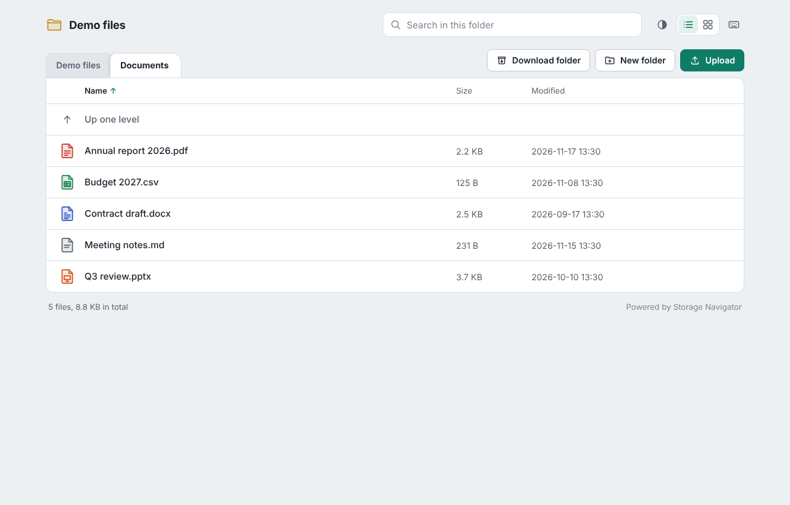
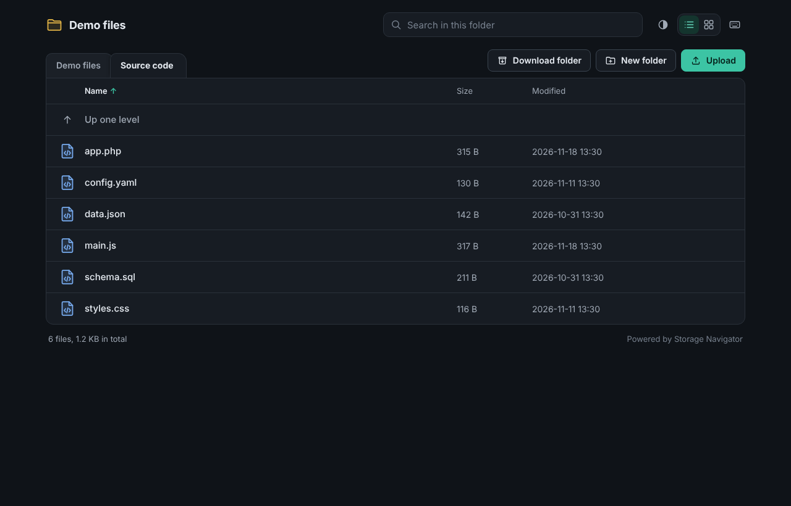
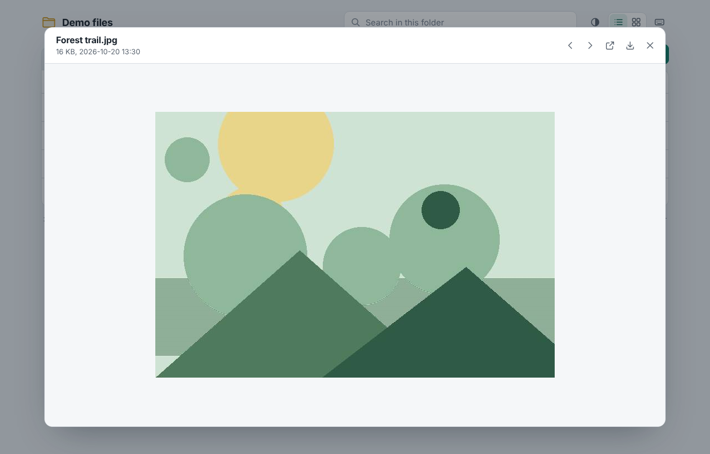
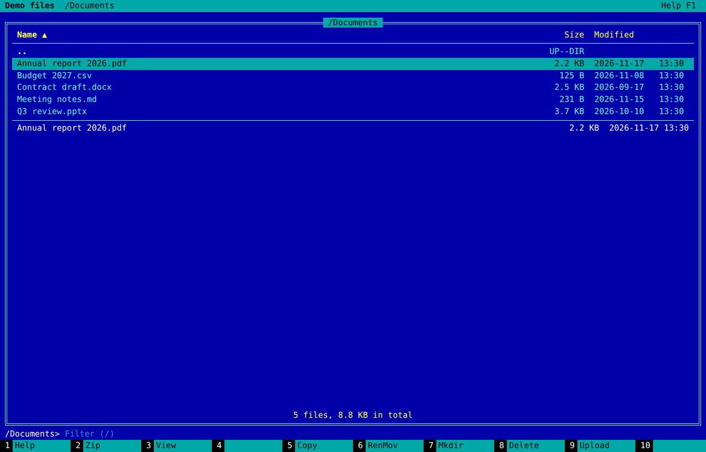
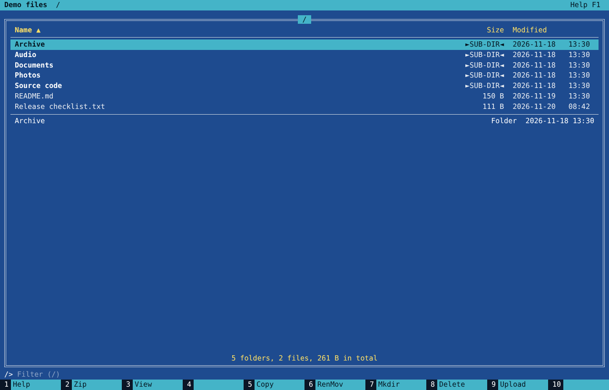
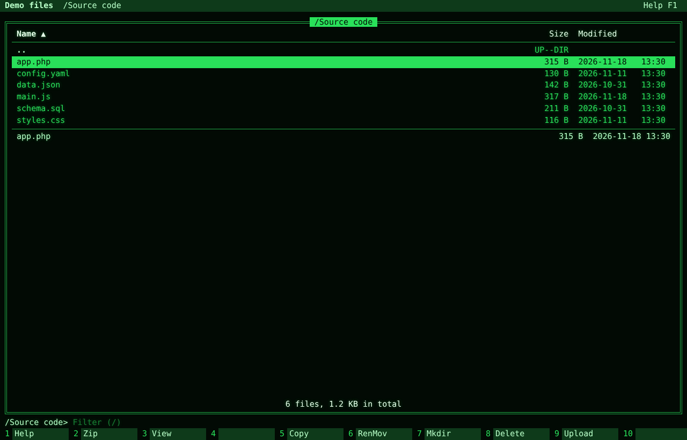
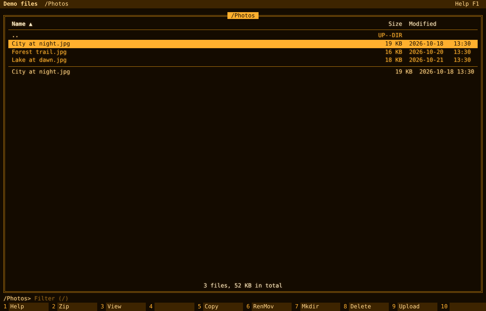

# Storage Navigator

[](https://packagist.org/packages/marktaborosi/storage-navigator)
[](https://github.com/marktaborosi/storage-navigator/actions/workflows/ci.yml)
[](composer.json)
[](https://packagist.org/packages/marktaborosi/storage-navigator)
[](LICENSE)

A secure, themeable file browser for PHP. Point it at a folder, an S3 bucket, an FTP or SFTP server or an archive, and your users can browse, search, preview and download files, and optionally upload, rename and delete them.

It is a single PSR-15 request handler: it works in plain PHP with one line, and in any framework that speaks PSR-7.



| Dark mode | Grid view and preview | Norton Commander theme |
| --- | --- | --- |
|  |  |  |

## Contents

- [Features](#features)
- [Installation](#installation)
- [Quick start](#quick-start)
- [Using it in a framework](#using-it-in-a-framework)
- [Storages](#storages)
- [Configuration](#configuration)
- [Permissions and write operations](#permissions-and-write-operations)
- [Filters](#filters)
- [Themes and customization](#themes-and-customization)
- [Security](#security)
- [Keyboard shortcuts](#keyboard-shortcuts)
- [Using it from code](#using-it-from-code)
- [Upgrading from 2.x](#upgrading-from-2x)
- [Development](#development)

## Features

- **Any storage** through [Flysystem](https://flysystem.thephpleague.com/): local disk, Amazon S3 and S3-compatible services, FTP(S), SFTP, ZIP files, plus read-only RAR, 7z and TAR archives.
- **Browse**: folder path, live search, sorting, list and grid views with image thumbnails, full keyboard control.
- **Preview** images, video and audio (with seeking), PDF, and text or source code with line numbers and highlighting, without downloading.
- **Download** files, or whole folders as a streamed ZIP file.
- **Manage** files: upload (drag and drop, progress), new folder, rename, delete. All off by default.
- **Secure by default**: the root cannot be escaped, hidden files stay hidden, every limit and permission is enforced on the server, CSRF protection, a strict Content Security Policy.
- **Themes**: a modern light and dark theme, and four retro console themes (Norton Commander, Midnight Commander, hacker green, amber terminal).
- **English and Hungarian** interface; add your own language in one file.
- No build step and no JavaScript dependencies. Browsing and downloads work without JavaScript too.

## Installation

```bash
composer require marktaborosi/storage-navigator
```

Requires PHP 8.3 or newer. Add the package for the storage you need:

| Storage | Package |
| --- | --- |
| Local disk | included |
| Amazon S3 and compatible services | `league/flysystem-aws-s3-v3` |
| FTP / FTPS | `league/flysystem-ftp` |
| SFTP | `league/flysystem-sftp-v3` |
| ZIP files (read and write) | `league/flysystem-ziparchive` |
| RAR, 7z, TAR and other archives (read-only) | `wapmorgan/unified-archive` |
| Folder download as ZIP | `maennchen/zipstream-php` |

## Quick start

```php
<?php

use Marktaborosi\StorageNavigator\StorageNavigator;
use Marktaborosi\StorageNavigator\Storage\Storage;

require __DIR__ . '/vendor/autoload.php';

(new StorageNavigator(Storage::local(__DIR__ . '/files')))->handleGlobals();
```

That is a read-only browser of the `files` directory. The navigator does not log users in: put it behind your application's authentication.

To try it with sample files and every feature enabled:

```bash
composer install
php -S localhost:8000 -t examples/demo
# other themes and languages:
SN_THEME=norton-commander SN_LOCALE=hu php -S localhost:8000 -t examples/demo
```

## Using it in a framework

`StorageNavigator` implements `Psr\Http\Server\RequestHandlerInterface`: it takes a PSR-7 request and returns a PSR-7 response. Route the GET, HEAD and POST methods of one URL to it. Its links are relative query strings, so it works under any path.

**Any PSR-15 framework** (Slim, Mezzio, Laminas):

```php
$app->any('/files', fn (ServerRequestInterface $request) => $navigator->handle($request));
```

**Laravel** (install `symfony/psr-http-message-bridge` and `nyholm/psr7`, which let Laravel inject PSR-7 requests and return PSR-7 responses):

```php
use Illuminate\Foundation\Http\Middleware\ValidateCsrfToken;
use Psr\Http\Message\ServerRequestInterface;

Route::match(['get', 'head', 'post'], '/files', function (ServerRequestInterface $request) {
    return app(StorageNavigator::class)->handle($request);
})->middleware('auth')->withoutMiddleware(ValidateCsrfToken::class);
```

The navigator has its own CSRF protection, so Laravel's is not needed on this route.

**Symfony** (with `symfony/psr-http-message-bridge`):

```php
#[Route('/files', methods: ['GET', 'HEAD', 'POST'])]
#[IsGranted('ROLE_USER')]
public function files(Request $request, StorageNavigator $navigator): Response
{
    $psr17 = new Psr17Factory();
    $psrRequest = (new PsrHttpFactory($psr17, $psr17, $psr17, $psr17))->createRequest($request);

    return (new HttpFoundationFactory())->createResponse($navigator->handle($psrRequest), streamed: true);
}
```

`handleGlobals()` streams folder ZIP downloads straight to the client. Through a framework bridge the archive is first written to a temporary stream (in memory up to 2 MB, then on disk).

## Storages

```php
use Marktaborosi\StorageNavigator\Storage\Storage;

Storage::local('/srv/shared');                       // a directory
Storage::s3($s3Client, 'bucket', 'optional/prefix'); // S3, MinIO, R2, Wasabi, GCS interoperability
Storage::ftp(['host' => 'ftp.example.com', 'username' => 'u', 'password' => 'p', 'ssl' => true]);
Storage::sftp(host: 'example.com', username: 'deploy', hostFingerprint: 'SHA256:…', privateKey: '/home/me/.ssh/id_ed25519');
Storage::zip('/srv/backup.zip');                     // readable and writable
Storage::archive('/srv/photos.rar');                 // read-only: RAR, 7z, TAR, ZIP …
Storage::flysystem($anyFilesystemOperator, 'optional/sub/folder');
Storage::memory();                                   // empty, for tests and demos
```

`Storage::local()` hides symbolic links and checks every access with `realpath()`, so a link inside the folder cannot lead outside it. `Storage::sftp()` asks for the server's key fingerprint on purpose: without it, a man-in-the-middle can capture the credentials. Pass `null` only on a trusted network.

Need something else? Any [Flysystem adapter](https://flysystem.thephpleague.com/docs/) works through `Storage::flysystem()`, or implement `StorageInterface` (four read methods) and `WritableStorageInterface` (four write methods).

## Configuration

Everything is set with named arguments of `Options`; all of them are optional.

```php
use Marktaborosi\StorageNavigator\{Features, Limits, Options, StorageNavigator};

$navigator = new StorageNavigator($storage, new Options(
    title: 'Project files',
    theme: 'modern',
    locale: 'hu',
    dateFormat: 'Y. m. d. H:i',
    timezone: 'Europe/Budapest',
    features: new Features(upload: true, createDirectory: true, rename: true, delete: true, zipDownload: true),
    limits: new Limits(maxUploadBytes: 100 * Limits::MIB),
    csrfSecret: $_ENV['STORAGE_NAVIGATOR_SECRET'],
    cacheDirectory: __DIR__ . '/var/cache/storage-navigator',
));
```

| Option | Default | Meaning |
| --- | --- | --- |
| `title` | `'Files'` | Page title and name of the top folder |
| `theme` | `'modern'` | A theme name (see [Themes](#themes-and-customization)) or a `Theme` object |
| `locale` | `'en'` | `en` or `hu`; unknown locales fall back to English |
| `translations` | `[]` | Override single UI strings, by key (see `resources/translations/en.php`) |
| `dateFormat` | `'Y-m-d H:i'` | PHP date format for the Modified column |
| `timezone` | PHP default | Time zone of displayed dates |
| `features` | read-only | What users may do; see below |
| `limits` | see below | Upload, ZIP and preview limits |
| `filter` | none | Entries that do not match are invisible and inaccessible |
| `showHidden` | `false` | Show dotfiles such as `.env` and `.git` |
| `csrfSecret` | none | At least 32 random characters; required for write features |
| `authorize` | none | Callback deciding every operation; see below |
| `allowedUploadExtensions` | any | Only these extensions may be uploaded |
| `deniedUploadExtensions` | executables | Never accepted for uploads or renames (`php`, `phtml`, `phar`, `cgi`, `htaccess` …) |
| `overwriteUploads` | `false` | Replace existing files on upload instead of rejecting them |
| `securityHeaders` | `true` | Send the Content Security Policy and related headers |
| `assetsUrl` | none | Serve the CSS and JS from your own URL or CDN instead of through the handler |
| `templatePaths` | `[]` | Directories with templates that override the built-in ones |
| `logger` | none | PSR-3 logger for storage failures (clients only see a generic message) |
| `cacheDirectory` | none | Twig template cache; recommended in production |

`Limits`: `maxUploadBytes` (64 MB), `maxZipBytes` (1 GB), `maxZipEntries` (10 000), `maxTextPreviewBytes` (2 MB). PHP's `upload_max_filesize` and `post_max_size` still apply.

## Permissions and write operations

`Features` switches operations on and off. Read features are on by default, write features are off:

```php
new Features(
    navigation: true,       // open sub-folders
    download: true,
    preview: true,
    zipDownload: false,     // needs maennchen/zipstream-php
    upload: false,
    createDirectory: false,
    rename: false,
    delete: false,
);
Features::readOnly(zipDownload: true);
Features::all();
```

Write features need a writable storage and `csrfSecret`. Generate the secret once and keep it in your configuration:

```bash
php -r 'echo bin2hex(random_bytes(32)), PHP_EOL;'
```

For per-user rules, pass `authorize`. It is called for every operation the features allow, with the path it applies to and the request, so you can read your session or user attribute:

```php
use Marktaborosi\StorageNavigator\Path\Path;
use Marktaborosi\StorageNavigator\Security\Operation;

authorize: function (Operation $operation, Path $path, ServerRequestInterface $request) use ($user): bool {
    if (!$operation->isWrite()) {
        return true;
    }

    return $user->isAdmin() || $path->isDescendantOf(Path::fromString('uploads/' . $user->id));
},
```

Operations: `List`, `Download`, `Preview`, `ZipDownload`, `Upload`, `CreateDirectory`, `Rename`, `Delete`. The interface only offers what the same rules allow.

## Filters

A filter decides what exists for the user. An entry it rejects is not listed, and it cannot be opened, downloaded, previewed, renamed or deleted either; a rejected folder hides everything inside it.

```php
use Marktaborosi\StorageNavigator\Filter\Filter;

filter: Filter::all(
    Filter::not(Filter::name('*.log', 'Thumbs.db', 'node_modules')),
    Filter::not(Filter::path('private', 'private/*')),
),
```

| Filter | Matches |
| --- | --- |
| `Filter::name('*.pdf', 'README*')` | Entry name, shell-style patterns, case-insensitive |
| `Filter::path('reports/2026/*')` | Path from the root; `*` also matches slashes |
| `Filter::extension('jpg', 'png')` | Files with these extensions; folders always pass |
| `Filter::files()`, `Filter::directories()` | Entry type |
| `Filter::hidden()` | Dotfiles |
| `Filter::callback(fn (Entry $e) => $e->size < 10_000_000)` | Anything you like |
| `Filter::all(...)`, `Filter::any(...)`, `Filter::not(...)` | Combinations |

## Themes and customization

| Theme | Look |
| --- | --- |
| `modern` | Light or dark following the system, with a switch in the header |
| `modern-light`, `modern-dark` | Fixed light or dark |
| `norton-commander` | DOS blue panel with function keys |
| `midnight-commander` | Softer blue, white files |
| `hacker` | Green phosphor |
| `terminal` | Amber phosphor |

| Midnight Commander | Hacker | Terminal |
| --- | --- | --- |
|  |  |  |

**Colours and fonts.** Every colour is a CSS custom property. Load an extra stylesheet that overrides them:

```php
use Marktaborosi\StorageNavigator\Rendering\Theme;

theme: Theme::custom('brand', Theme::LAYOUT_MODERN, ['modern.css', '/css/files-brand.css']),
```

```css
/* /css/files-brand.css */
:root {
  --sn-accent: light-dark(#5b3cc4, #a48cf5);
  --sn-accent-soft: light-dark(#eee9fb, #2a2147);
  --sn-font: "Inter", system-ui, sans-serif;
}
```

The console themes use `--nc-*` properties the same way (see `resources/assets/console-norton-commander.css`).

**Templates.** Copy any file from `resources/templates` into your own directory, keeping its relative path, and pass that directory in `templatePaths`. The view data each template receives is built in `src/View/ViewFactory.php`.

**Assets.** The CSS and JavaScript are served through the handler with long-lived cache headers. To serve them from your web server or a CDN, copy `resources/assets` there and set `assetsUrl`.

## Security

What the navigator enforces on the server:

- **The root cannot be escaped.** Every client path goes through `Path`, which rejects `..`, control characters and invalid UTF-8. Local storage also blocks symbolic links that point outside.
- **Hidden means inaccessible.** Dotfiles (unless `showHidden`) and filtered entries cannot be listed, downloaded, previewed, renamed or deleted, and a folder holding such entries cannot be deleted.
- **Disabled means disabled.** A feature that is off, or an operation `authorize` rejects, answers 403 even to hand-made requests.
- **Writes are protected** by a signed, SameSite=Strict CSRF token, and only accept POST.
- **Uploads are checked** against the deny list (every extension part, so `shell.php.jpg` is rejected), the size limit and existing files, before anything is written.
- **Previews cannot run code.** Text, HTML and source files are served as `text/plain`; inline responses carry a sandboxing Content Security Policy and `nosniff`.
- **Pages are locked down** by a Content Security Policy without `unsafe-inline`; file names only ever reach the page as escaped text.

What remains your job:

- Authenticate users before they reach the navigator.
- Keep the browsed folder outside your web server's document root, so uploaded files can never be executed or served directly.
- Keep `csrfSecret` secret and set sensible `Limits`.

Found a vulnerability? Please report it privately, as described in [SECURITY.md](SECURITY.md).

## Keyboard shortcuts

| Key | Modern theme | Console themes |
| --- | --- | --- |
| Arrow keys, Home, End, Page Up/Down | Move | Move |
| Enter | Open folder or file | Open folder or file |
| Space | Preview | Preview |
| Backspace, Alt + Up | Parent folder | Parent folder |
| `/` | Search | Filter |
| N | New folder | New folder |
| U | Upload | Upload |
| Delete | Delete | Delete |
| F2 | Rename | Download folder as ZIP |
| F3, F5, F6, F7, F8, F9 | | Preview, Download, Rename, New folder, Delete, Upload |
| `?` | Show shortcuts | Show shortcuts (also F1) |

In the preview, the left and right arrow keys move to the previous and next file.

## Using it from code

```php
$listing = $navigator->listing('reports/2026');      // visible entries, sorted by name
foreach ($listing->sorted(SortField::Size, SortDirection::Descending) as $entry) {
    echo $entry->name(), ' ', $entry->size, PHP_EOL;
}

echo (new TextRenderer())->render($listing);         // a plain-text table for CLI scripts
```

The listing is also available as JSON: send `Accept: application/json` with any listing URL.

## Upgrading from 2.x

Version 3 is a rewrite with a new API. The main changes:

- Adapters are replaced by `Storage::*()` factories on top of Flysystem.
- `new StorageNavigator($adapter, $renderer, $rootPath, $filterBuilder)` becomes `new StorageNavigator($storage, new Options(...))`, and `display()` becomes `handleGlobals()` or `handle($request)`.
- `FileStructureFilterBuilder` becomes `Filter`.
- Theme names changed; the old names still work and raise a deprecation notice.
- PHP 8.3 is required, and the storage packages are optional.

[UPGRADE-3.0.md](UPGRADE-3.0.md) maps every 2.x class to its replacement.

## Development

```bash
composer install
composer test       # PHPUnit
composer analyse    # PHPStan, highest level
php -S localhost:8000 -t examples/demo
```

Pull requests are welcome; see [CONTRIBUTING.md](CONTRIBUTING.md). Changes are listed in [CHANGELOG.md](CHANGELOG.md).

## License

MIT. See [LICENSE](LICENSE).
